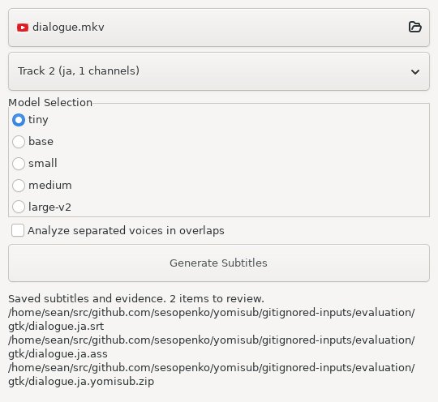

# sesopenko/yomisub

**yomisub** is a desktop application for automatically generating subtitles for video files using
whisper.cpp. It is designed to assist with language learning by enabling users to watch foreign
television shows and movies with native-language subtitles, even when official subtitles are unavailable.



The application includes:

- A GTK-based graphical user interface
- File picker for selecting video files
- Audio track selection for videos with multiple language tracks
- Whisper model selection (e.g., tiny, base, medium, large-v2)
- SRT, ASS and a replayable listening bundle saved beside the video

This tool was created to support language immersion and comprehension, particularly for learners of Japanese.

---

## Debian 13 setup

Install [uv](https://docs.astral.sh/uv/getting-started/installation/) and the native
dependencies below. The Python project uses Python 3.13 on x86-64. Enable Debian's
`non-free-firmware` repository component for AMD firmware.

```bash
sudo apt update
sudo apt install build-essential pkg-config python3-dev libcairo2-dev \
  libgirepository-2.0-dev gir1.2-gtk-3.0 ffmpeg git cmake libvulkan-dev \
  glslc mesa-vulkan-drivers vulkan-tools firmware-amd-graphics
```

### Build the Vulkan transcription engine

Build [whisper.cpp v1.9.5](https://github.com/ggml-org/whisper.cpp/releases/tag/v1.9.5)
once. Add the build's `bin` directory to your shell startup file to keep
`whisper-cli` available in future terminals.

```bash
git clone --branch v1.9.5 --depth 1 https://github.com/ggml-org/whisper.cpp.git "$HOME/.local/src/whisper.cpp"
cmake -S "$HOME/.local/src/whisper.cpp" -B "$HOME/.local/src/whisper.cpp/build" \
  -DCMAKE_BUILD_TYPE=Release -DGGML_VULKAN=ON
cmake --build "$HOME/.local/src/whisper.cpp/build" --parallel --target whisper-cli
export PATH="$HOME/.local/src/whisper.cpp/build/bin:$PATH"
vulkaninfo --summary
```

### Install speaker analysis

The required speaker scan uses a separate Python 3.12 ROCm environment and pinned pyannote weights. Install the worker and run its device probe before generating subtitles. The application displays setup instructions if it cannot analyze speakers. [AMD worker setup](runtime/amd/README.md)

### Install and run yomisub

From the yomisub checkout, move any legacy `.venv` aside before the first sync.

```bash
uv sync --locked
uv run --locked python yomisub.py
```

Choose a model that fits in your GPU's VRAM. The app downloads the selected
multilingual model on first use and caches it in `~/.cache/yomisub/models/`.

To verify GPU use, generate subtitles for a short video with a language-tagged
audio track and the `tiny` model. Inspect the evidence manifest for the verified
Vulkan and ROCm physical device IDs in the model runs. Mesa may
display the RX 9060 XT as `AMD Radeon Graphics (RADV GFX1200)`. When multiple
GPUs are available, use the Radeon device index from `vulkaninfo --summary` with
`GGML_VK_VISIBLE_DEVICES`. This example selects physical device 1.

```bash
GGML_VK_VISIBLE_DEVICES=1 uv run --locked python yomisub.py
```

## Generating subtitles

Select a video and a language-tagged audio track. Medium is the default continuous transcription model. Select **Analyze separated voices in overlaps** to also save two listening stems and request large-v3 readings of eligible two-voice excerpts. Enabled or disabled, contextual retries on the original mix use full large-v3 when the speaker scan detects overlap.

**Generate Subtitles** writes `<stem>.<language>.srt`, `<stem>.<language>.ass` and `<stem>.<language>.yomisub.zip` beside the video. The result shows the three paths and the number of distinct items to review. Voice labels identify speakers within this recording. Use the original audio, alternatives and timing evidence in the ZIP to review an uncertain attribution and replay your corrections. [Offline replay](#offline-evidence-replay)

## Development

`yomisub.py` launches the application. The `yomisub/` package contains the GTK interface,
subtitle workflow, and adapters for media probing and extraction, model caching, Whisper
transcription, diarization, evidence replay and subtitle publication.

Run the unit tests after installing the project dependencies. The tests run without
a display, downloads, or media binaries.

```bash
uv run --locked python -m unittest discover -s tests
```

## Compute configuration

The subtitle rebuild reads `yomisub/compute.toml` under `$XDG_CONFIG_HOME` (default
`~/.config`). Configure a physical GPU by PCI address or provider-reported UUID.
A stage can override the default device and select a provider. For example:

```toml
default_device = "pci:0000:03:00.0"

[stages.diarization]
provider = "amd-rocm"
device = "pci:0000:0b:00.0"
```

The stages are `baseline_asr`, `retry_asr`, `diarization`, `separation`, and
`stem_asr`. With no applicable preference, a sole compatible binding is selected.
Multiple compatible bindings require an explicit choice. Runtime GPU ordinals
are resolved separately by each provider when binding a stage.

The AMD speaker worker has its own Python 3.12 environment. Follow the
installation and model-access steps to check the diarizer on your selected
GPU. [AMD worker setup](runtime/amd/README.md)

## Offline evidence replay

Open the bundle as a ZIP to inspect `manifest.json` and the indexed listening WAVs. The manifest records the exact recording clock, source ancestry, model runs, raw hypotheses, active voices, rejected readings, planned lanes and open findings. Replay uses its saved Japanese segmentation and works offline.

```sh
uv run --locked python -m yomisub.replay clip.ja.yomisub.zip review/
uv run --locked python -m yomisub.replay clip.ja.yomisub.zip corrected/ --corrections edits.json
```

Replay writes SRT and ASS into a directory with unused destination filenames. Copy the manifest's `id` into `bundle` and copy a candidate or planned phrase ID into `target`. Listener timing uses integer samples on the recording clock. Each edit carries a unique ID and the listener who verified it.

```json
{"bundle":"<manifest id>","edits":[
  {"id":"review-1","target":"<phrase id>","listener":"editor","field":"wording","value":"待って"},
  {"id":"review-2","target":"<phrase id>","listener":"editor","field":"start","value":16000}
]}
```

Other fields include `end`, `owner` (a neutral listener label or null), and `suppress`. A replacement displays as one phrase. To supply timed subdivisions, add a `parts` array with `text`, `start` and `end` for each piece of the replacement. A verified second line can use `field: "add"` with the turn ID as its target, text in `value`, `start`, `end`, and optional `owner`. An interval note uses `field: "note"`, its text in `value`, and both edges. The automatic bundle keeps its original evidence and wording.

## License

© 2025 Sean Esopenko. [MIT License](LICENSE.txt)
